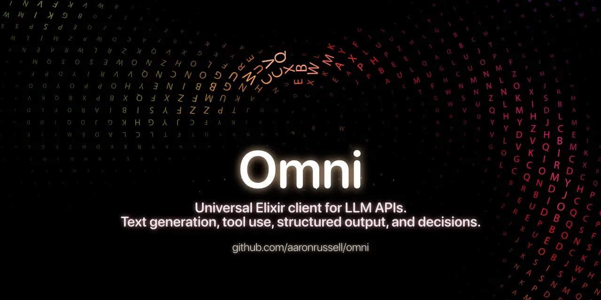

# Omni




**Universal Elixir client for LLM APIs.**
Text generation, tool use, structured output and decisions across many providers.

## Features

- **One API, many providers.** Anthropic, OpenAI, Google and 14 more are built in. Any provider in the [models.dev](https://models.dev) catalog loads by its id, and your own inference server needs only config.
- **Streaming first.** Every text request streams. Handle events as they arrive, or wait for the finished response.
- **Tool use.** Give the model tools with a schema and a handler. Omni runs them and feeds the results back until the model answers.
- **Structured output.** Pass a JSON Schema and get back a validated map, with retries when the model misses.
- **Thinking.** One `:thinking` option, translated to whatever each model accepts.
- **Decisions.** Ask decision models typed questions and get probabilities back, over TypeSafe's System One or OpenAI's Decisions API.
- **A model catalog included.** Limits, prices and capabilities for thousands of models ship with the package, with live updates as an option.

## Installation

Add Omni to your dependencies:

```elixir
def deps do
  [
    {:omni, "~> 2.0"}
  ]
end
```

Each built-in provider reads its API key from its usual environment variable (`ANTHROPIC_API_KEY`, `OPENAI_API_KEY`, `GEMINI_API_KEY` and so on). If your keys are set, there is nothing to configure.

## Usage

Generate text by naming a model and giving it a prompt:

```elixir
{:ok, response} = Omni.generate_text("anthropic:claude-sonnet-5-5", "Why is the sky blue?")

response.message
#=> %Omni.Message{role: :assistant, content: [%Omni.Content.Text{text: "Sunlight is..."}]}
```

Stream the response as it is written:

```elixir
{:ok, stream} = Omni.stream_text("openai:gpt-6.1-sol", "Tell me a story")

{:ok, response} =
  stream
  |> Omni.StreamingResponse.on(:text_delta, fn %{delta: text} -> IO.write(text) end)
  |> Omni.StreamingResponse.complete()
```

Ask a decision model typed questions and get probabilities back:

```elixir
{:ok, decision} =
  Omni.decide("openrouter:typesafe/jev-1.14", {ticket_text, [
    urgent: Omni.predicate("Does this need a reply within the hour?"),
    team: Omni.choice("Which team owns this?", [:billing, :infra, :other])
  ]})

decision.answers[:urgent]  #=> %Omni.Answer.Predicate{probability: 0.91}
decision.answers[:team]    #=> %Omni.Answer.Choice{choice: :infra, probabilities: [billing: 0.02, infra: 0.95, other: 0.03], confidence: 0.93}
```

## Documentation

The guides and API reference are on [HexDocs](https://omni.hexdocs.pm):

- [Getting started](https://omni.hexdocs.pm/getting-started.html) - start here, install and make your first requests
- [Text generation](https://omni.hexdocs.pm/text-generation.html) - conversations, streaming, thinking, tools and structured output
- [Decisions](https://omni.hexdocs.pm/decisions.html) - typed questions answered with probabilities, for routing, classifying and scoring
- [Providers and models](https://omni.hexdocs.pm/providers-and-models.html) - configuring providers, adding your own, and model data
- [Built-in providers](https://omni.hexdocs.pm/built-in-providers.html) - each provider's id, API key variable and quirks
- [Upgrading to v2](https://omni.hexdocs.pm/upgrading-to-v2.html) - what's new and what to change when coming from v1

To build agents on top of Omni, see [`omni_agent`](https://github.com/aaronrussell/omni_agent).

## License

This package is open source and released under the [Apache-2 License](https://github.com/aaronrussell/omni/blob/master/LICENSE).

© Copyright 2024-2026 [Push Code Ltd](https://www.pushcode.com/).
