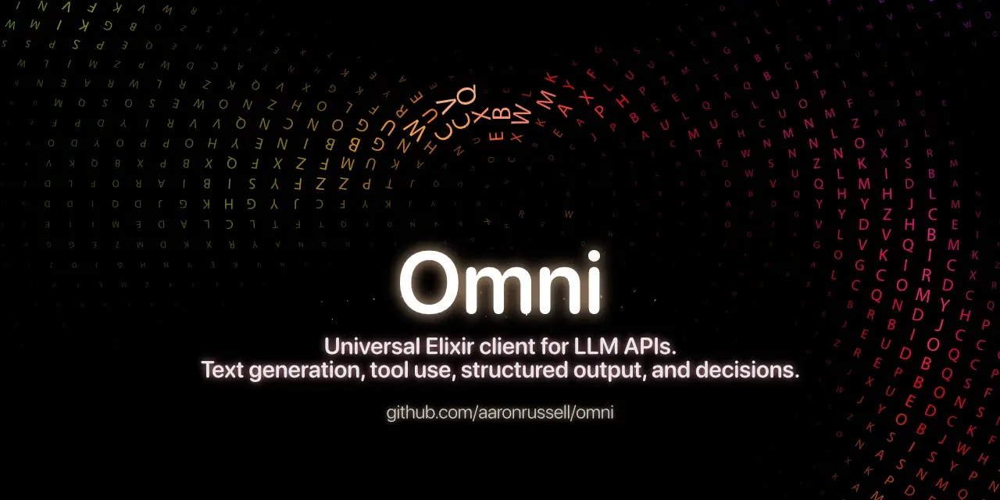

# Getting started



Omni is an Elixir client for LLM APIs. One set of functions covers text generation, streaming, tool use, structured output and decisions, across Anthropic, OpenAI, Google and many other providers. Changing model means changing one argument.

## Install

Add Omni to your dependencies:

```elixir
def deps do
  [
    {:omni, "~> 2.0"}
  ]
end
```

## Set an API key

Each built-in provider reads its key from the environment variable that provider's own tools use: `ANTHROPIC_API_KEY`, `OPENAI_API_KEY`, `GEMINI_API_KEY` and so on. If the variable is set, there is nothing to configure. [Built-in providers](built-in-providers.md) lists every provider and its variable.

To read a key from somewhere else, configure the provider by its id:

```elixir
# config/runtime.exs
config :omni, :providers,
  anthropic: [api_key: {:system, "MY_ANTHROPIC_KEY"}],
  openai: [api_key: {MyApp.Secrets, :fetch, ["openai"]}]
```

You can also pass `:api_key` on any request.

## Generate text

Name a model and give it a prompt:

```elixir
{:ok, response} = Omni.generate_text("anthropic:claude-sonnet-5-5", "Why is the sky blue?")

response.message
#=> %Omni.Message{role: :assistant, content: [%Omni.Content.Text{text: "Sunlight is..."}]}

response.usage
#=> %Omni.Usage{input_tokens: 14, output_tokens: 120, total_cost: 0.0018, ...}
```

A model is named by its provider id and model id, as a string (`"anthropic:claude-sonnet-5-5"`) or a tuple (`{:anthropic, "claude-sonnet-5-5"}`). To see what a provider offers:

```elixir
{:ok, models} = Omni.list_models(:anthropic)
Enum.map(models, & &1.id)
#=> ["claude-fable-5", "claude-fable-5-1", "claude-haiku-4-5", ...]
```

For a conversation, pass a context with a system prompt and messages:

```elixir
context =
  Omni.context(
    system: "You are a patient physics tutor.",
    messages: [
      Omni.message("Why is the sky blue?"),
      Omni.message(role: :assistant, content: "Sunlight is scattered by the air..."),
      Omni.message("So why are sunsets red?")
    ]
  )

{:ok, response} = Omni.generate_text("anthropic:claude-sonnet-5-5", context)
```

## Stream the response

`Omni.stream_text/3` takes the same arguments and returns as soon as the response starts. Handle events as they arrive, then collect the finished response:

```elixir
alias Omni.StreamingResponse

{:ok, stream} = Omni.stream_text("anthropic:claude-sonnet-5-5", "Tell me a story")

{:ok, response} =
  stream
  |> StreamingResponse.on(:text_delta, fn %{delta: text} -> IO.write(text) end)
  |> StreamingResponse.complete()
```

## Give the model tools

A tool is a name, a description, a schema for its input and a function to run. Put tools in the context, and Omni runs each one the model asks for, sends the result back, and repeats until the model answers in text:

```elixir
weather_tool =
  Omni.tool(
    name: "get_weather",
    description: "Gets the current weather for a city",
    input_schema: Omni.Schema.object(%{city: Omni.Schema.string()}, required: [:city]),
    handler: fn input -> "18°C and cloudy in #{input.city}" end
  )

context =
  Omni.context(
    messages: [Omni.message("What's the weather in London?")],
    tools: [weather_tool]
  )

{:ok, response} = Omni.generate_text("anthropic:claude-sonnet-5-5", context)
```

## Get structured output

Pass a schema as `:output` and the answer comes back as a validated map:

```elixir
schema =
  Omni.Schema.object(
    %{
      name: Omni.Schema.string(description: "The capital city"),
      population: Omni.Schema.integer(description: "Approximate population")
    },
    required: [:name, :population]
  )

{:ok, response} =
  Omni.generate_text("anthropic:claude-sonnet-5-5", "What is the capital of France?", output: schema)

response.output
#=> %{name: "Paris", population: 2161000}
```

## Ask a decision model

Decision models are a different kind of model. They don't write text. They answer typed questions about an input with probabilities, in a single request:

```elixir
{:ok, decision} =
  Omni.decide("openrouter:typesafe/jev-1.14", {ticket_text, [
    urgent: Omni.predicate("Does this need a reply within the hour?"),
    team: Omni.choice("Which team owns this?", [:billing, :infra, :other])
  ]})

decision.answers[:urgent]
#=> %Omni.Answer.Predicate{probability: 0.91}

decision.answers[:team]
#=> %Omni.Answer.Choice{choice: :infra, probabilities: [billing: 0.02, infra: 0.95, other: 0.03], confidence: 0.93}
```

## Where next

- [Text generation](text-generation.md) for conversations, streaming events, thinking, attachments, tools and structured output in full.
- [Decisions](decisions.md) for the question types and how to read their answers.
- [Providers and models](providers-and-models.md) to choose which providers load, add providers and models of your own, and change where model data comes from.
- [Built-in providers](built-in-providers.md) for each provider's id, API key variable and quirks.
- [Upgrading to v2](upgrading-to-v2.md) if you are coming from Omni 1.x.

To build agents on top of Omni, with state, sessions and long-running loops, see [`omni_agent`](https://github.com/aaronrussell/omni_agent).
